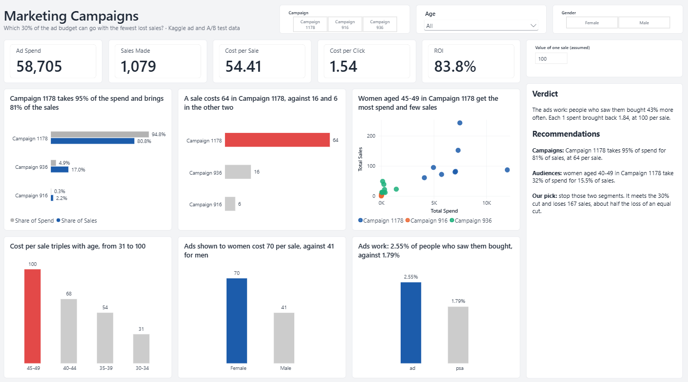

# Marketing Campaign Analysis

**Which 30% of the ad budget can go while losing the fewest sales, and do the ads work at all?** Cost-per-sale analysis of 1,143 ads and an A/B test of 588,101 people, in PostgreSQL and Power BI.

**Tools:** Excel · PostgreSQL · Power BI (DAX, what-if parameter)

## Demo

<!-- In the GitHub editor, drag images/slicer_demo.mp4 onto the line below to embed the video -->

https://github.com/user-attachments/assets/82bdd4c9-5ae0-4e6c-ba03-3cf875b48770

A 30-second walkthrough of the slicers and the sale value slider changing the return. [Download the video](images/slicer_demo.mp4)

## The problem

A company spent about 58,700 on three social media ad campaigns (916, 936 and 1178). The advertising budget is being cut by 30%, and the head of marketing has three options:

1. Cut every campaign by the same 30%
2. Cut the biggest campaign and leave the two small ones alone
3. Stop advertising to the audiences that cost the most per sale

The finance director also doubts that the ads work at all, so the company ran an experiment: most people saw ads, and a control group saw none.

*The company story and the value of a sale (100) are invented for this project.*

## The data

- **Ad data:** [Sales Conversion Optimization](https://www.kaggle.com/datasets/loveall/clicks-conversion-tracking), 1,143 ads from an anonymous company, with spend, clicks, enquiries and sales per ad.
- **Experiment data:** [Marketing A/B Testing](https://www.kaggle.com/datasets/faviovaz/marketing-ab-testing), 588,101 people, each in the ad group or the control group.

See [data/README.md](data/README.md).

## What I did

1. **Checked both files in Excel and PostgreSQL** ([cleaning log](docs/cleaning_log.md), [Excel checks](docs/excel_checks.md)).
2. **Built cost per sale and return** for each campaign, age, gender and interest, always dividing totals rather than averaging per-ad rates ([queries](sql/04_ad_questions.sql)).
3. **Ranked 24 audience segments** by cost per sale with a running total of spend, to find the cheapest way to cut 30%.
4. **Ran an A/B test** with a two-proportion z-test to check whether ads raise sales ([test](sql/05_ab_test.sql)).
5. **Built a one-page Power BI dashboard** with DAX measures and a slider for the value of a sale ([measures](docs/dax_measures.md)).

## What I found

- **Overall:** each 1 spent brought back 1.84, a return of 83.8%, if a sale is worth 100. A sale costs 54.41 on average.
- **Campaigns:** Campaign 1178 takes 95% of the spend and brings 81% of the sales. A sale costs 64 there, against 16 in Campaign 936 and 6 in Campaign 916.
- **Age:** cost per sale triples with age, from 31 for ages 30-34 to 100 for ages 45-49.
- **Gender:** ads shown to women cost 70 per sale, against 41 for men.
- **Waste:** 559 ads produced no sale and cost 14,754, a quarter of all spend.

## Do the ads work? The A/B test

| Group | People | Buyers | Conversion rate |
| --- | --- | --- | --- |
| Saw ads | 564,577 | 14,423 | 2.55% |
| Did not (control) | 23,524 | 420 | 1.79% |

People who saw ads were 43% more likely to buy. The z-score is 7.37, far above the 1.96 needed for 95% confidence, so the gap is not luck. Ads worked best for people who saw most of them on a Monday (3.32%).

## Recommendation

| Option | Spend removed | Sales lost |
| --- | --- | --- |
| Cut every campaign by 30% | 17,612 | about 324 |
| Take the whole cut from Campaign 1178 | 17,612 | about 276 |
| **Stop the two most expensive segments** | **19,005** | **167** |

**Pick: stop advertising to women aged 45-49 and 40-44 in Campaign 1178.** They take 32% of the budget and bring 15.5% of the sales, so the cut loses about half as many sales as cutting evenly.

## Limits

- The value of 100 per sale is an assumption. Below about 54 per sale, the ads lose money overall; the dashboard slider shows this.
- The two small campaigns spent very little. Nothing shows they would stay as efficient with more budget.
- Sales lost assumes sales fall in line with spend.
- The experiment groups are uneven (96% saw ads), and the two files come from different companies.

## How to reproduce

1. Download both files ([data/README.md](data/README.md)).
2. Run the files in [sql](sql) in number order in PostgreSQL. Each file has the expected result as a comment under every check.
3. Open [powerbi/marketing_dashboard.pbix](powerbi/marketing_dashboard.pbix) in Power BI Desktop. The data is saved inside the file; to refresh it, point it at your own PostgreSQL database.

## Files

| Folder | What is in it |
| --- | --- |
| [sql](sql) | Five SQL files, run in number order |
| [powerbi](powerbi) | The dashboard (.pbix and PDF) and the theme file |
| [docs](docs) | Cleaning log, data dictionary, Excel checks, DAX measures |
| [images](images) | Dashboard screenshot and slicer demo |
| [data](data) | Where to download the data |
